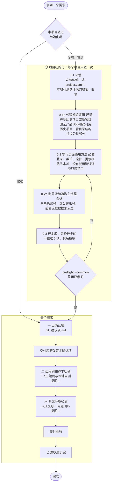
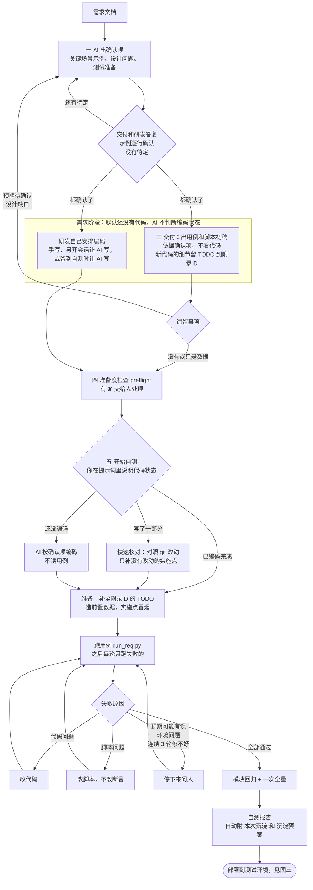
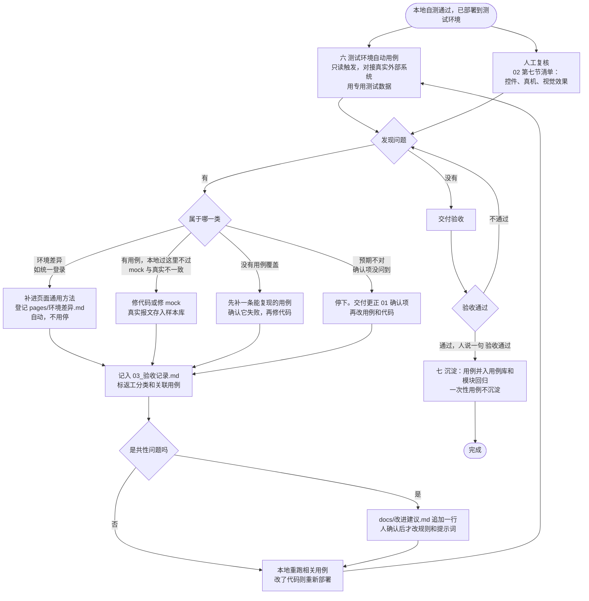

# 流程图

三张图：① 总览（首次和非首次）② 单个需求在本地开发环境 ③ 测试环境验证、问题闭环与沉淀。
图中「〇～七」对应 `docs/各阶段提示词.md` 的章节。图片在 `docs/流程图/`，下面是可编辑的源文件（Mermaid）。

## 图一：总览

## 图二：单个需求，本地开发环境

## 图三：测试环境验证、问题闭环与沉淀

## 沉淀什么时候发生

| 沉淀什么 | 什么时候 | 要不要人触发 |
|---|---|---|
| 页面通用方法、环境差异、造数方法、录制的真实报文 | 过程中发现就做 | 不用，自动 |
| 「本次沉淀」清单和沉淀预案 | 生成自测报告时 | 不用，自动 |
| 用例并入用例库和模块回归 | 交付验收通过后 | 要，人说「验收通过」 |
| 规则和提示词的改进 | 发现共性问题时 | AI 只提建议（`docs/改进建议.md`），人确认后才改 |
